

  

<h1 align="center">SakuraMedia</h1>

  <strong>把本地和网盘里的影片，变成可搜索、可订阅、可续看的媒体库。</strong>

  面向自建媒体库的用户：后端可部署在 NAS、迷你主机、服务器或 VPS 上；影片可以存本地，也可以存 115 网盘。

  <a href="https://github.com/tinypinglite/sakuramedia/releases/latest"><strong>下载客户端</strong></a>
  ·
  <a href="https://tinypinglite.github.io/sakuramedia/guide/quick-start"><strong>部署后端</strong></a>
  ·
  <a href="https://tinypinglite.github.io/sakuramedia/"><strong>查看 Wiki</strong></a>
  ·
  <a href="https://tinypinglite.github.io/sakuramedia/videos/sakuramedia-demo.mp4"><strong>看演示</strong></a>

  
  

  需要一台 24 小时运行的主机 + Docker；客户端不能单独使用。

  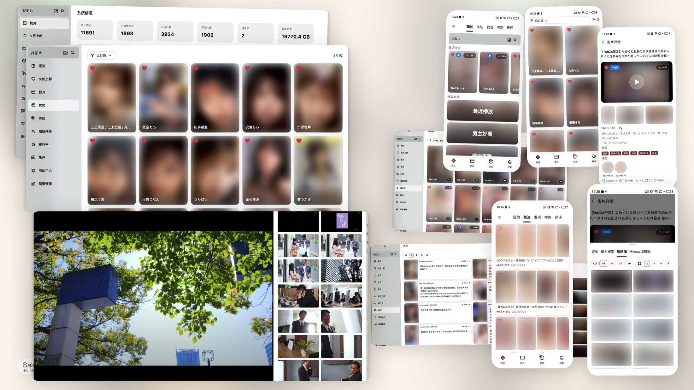

  收藏久了，我开始在意：这部影片里，我究竟想留下什么？ 
  <a href="https://tinypinglite.github.io/sakuramedia/guide/collection-strategy"><strong>为什么做 SakuraMedia →</strong></a>

## 核心功能

从找片、下载到观看和整理，当前版本覆盖以下能力。

### 找片与获取

- 🔍 **发现与订阅**：按番号搜索、按姓名查找女优；标签、排行榜、推荐；订阅女优持续追踪新作（不会自动下载她的全部作品）。
- 📥 **自动下载与入库**：订阅影片后定期寻找资源，通过 qBittorrent 或 115 离线下载；完成后自动导入媒体库，暂无资源的影片留在订阅清单。
- 📦 **导入与信息补全**：导入本地磁盘、NAS 挂载目录或 115 网盘；识别番号，刮削并补全标题、演员、封面等信息；识别失败可手动匹配。

### 观看与留下

- 🎬 **播放与时刻**：缩略图时间轴定位画面；标记时刻；把一段画面切成独立视频；支持倍速、字幕、续播和外部播放器。
- 🥽 **VR 播放**：调用外部播放器播放 VR 影片；多分段资源可合并连续播放；实验性支持 Pico 等设备以 2D 形式使用。
- 🖼️ **以图搜图**：用缩略图、剧情图或文字描述，找其他影片里的相似画面；有可播放来源的结果可直接跳到对应时间（可选，需额外部署嵌入服务；只搜已索引的库内图片）。
- ❤️ **收藏与整理**：播放列表、时刻合集、切片合集；用合集组织想回看的内容。

> 时刻依赖来源媒体；切片是独立视频文件。

### 普通视频（PornBox）

- 📼 **普通视频导入**：在「媒体导入 → 视频」选择存储中的目录或视频文件，导入时可直接加入合集；不需要番号，也不走 JAV 的订阅与下载流程。
- 🗂️ **合集组织**：在合集详情查看成员、手动排序，加入或移出成员；点「播放全部」按当前顺序开始。
- 🔗 **合集连播**：右侧缩略图面板把各集关键帧拼成一条；滚动或点选即可跳到对应视频和画面，播完自动进入下一部。
- 📌 **连播中标记时刻**：缩略图右键 →「添加标记」；时刻仍绑定具体视频和媒体，不会因为连播丢失。同一菜单也可以保存到本地；启用以图搜图后还能搜相似图片。

> PornBox 与 JAV 的番号、订阅和下载流程相互独立；合集只负责组织已经入库的普通视频。

### 管理与扩展

- 🗂️ **媒体库管理**：查看重复文件、多版本和失效媒体；采样文件指纹只读少量片段，跨库/跨存储识别重复。把本地影片通过 115 秒传迁移到网盘，保留媒体记录与播放进度；未命中会跳过并保留源文件。
- 🔔 **任务与通知**：任务中心查看下载、导入和后台任务；通知提醒，通知渠道可扩展。
- 🧩 **插件扩展**：存储、下载、排行榜、字幕、女优资料补全等能力通过插件接入。
- 💻 **多客户端**：Windows / macOS / Android / iOS；桌面端负责配置和集中管理，移动端用于浏览和观看，具体入口因平台而异。

## 界面

> 截图使用演示数据，封面与缩略图已虚化。完整演示见下方视频。

  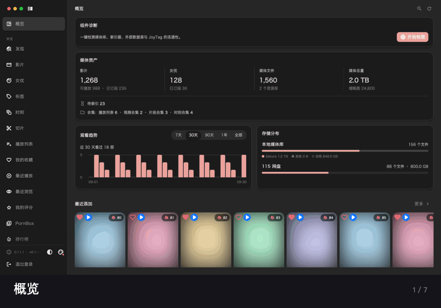

  概览 / 发现 / 详情 / 播放器 / 切片 / PornBox

  <a href="https://tinypinglite.github.io/sakuramedia/videos/sakuramedia-demo.mp4"><strong>▶ 看 45 秒完整演示</strong></a>

<strong>更多截图</strong>

  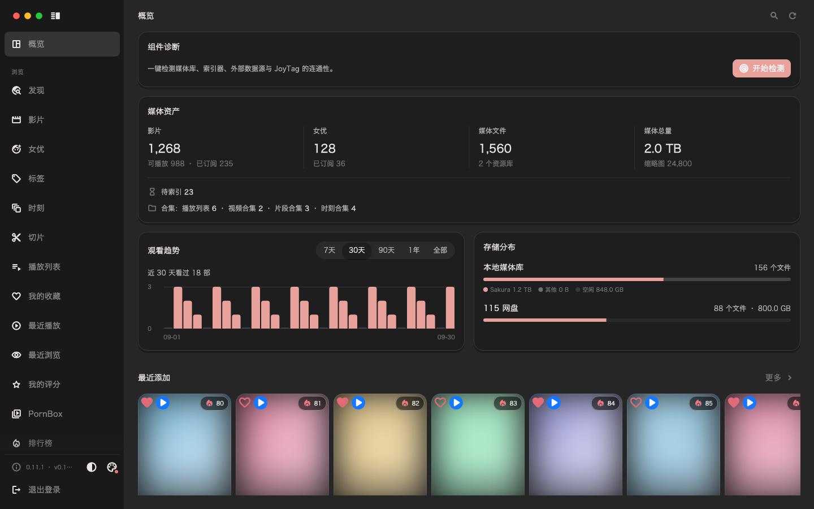

  概览：媒体资产、观看趋势、存储分布

  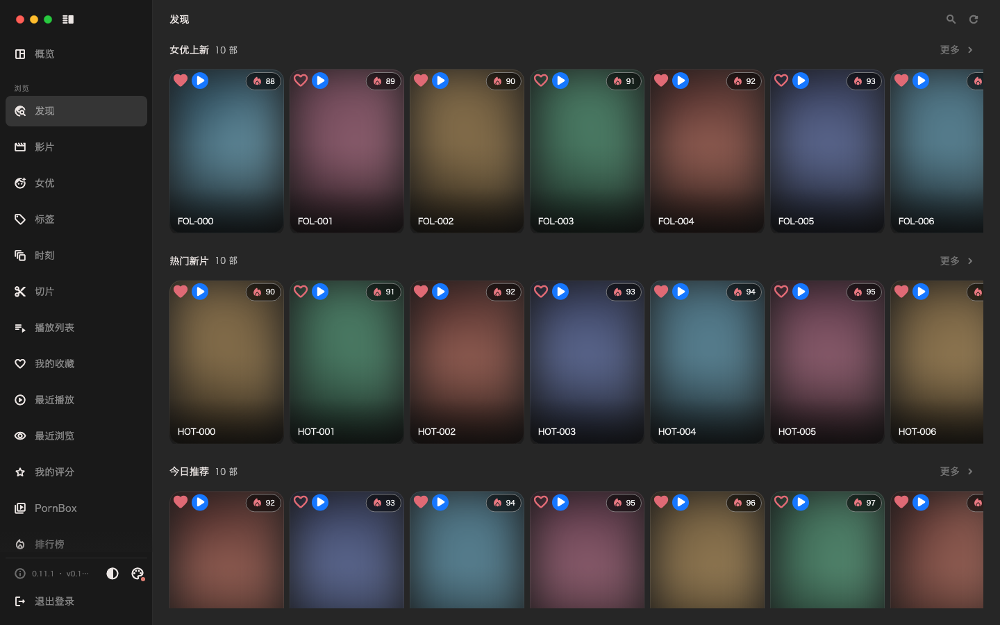
  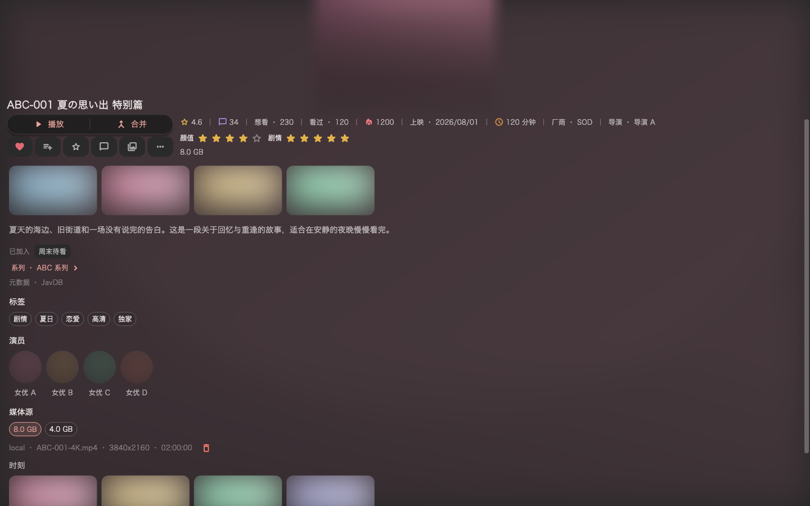

  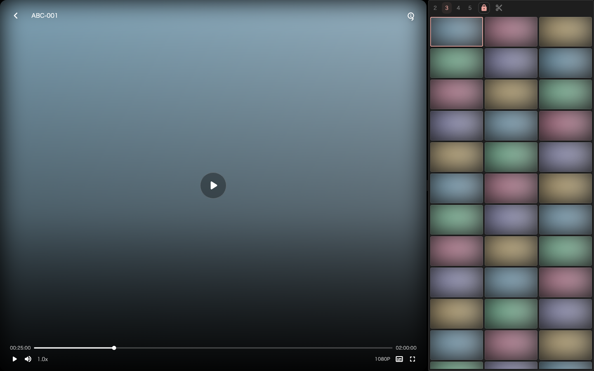

  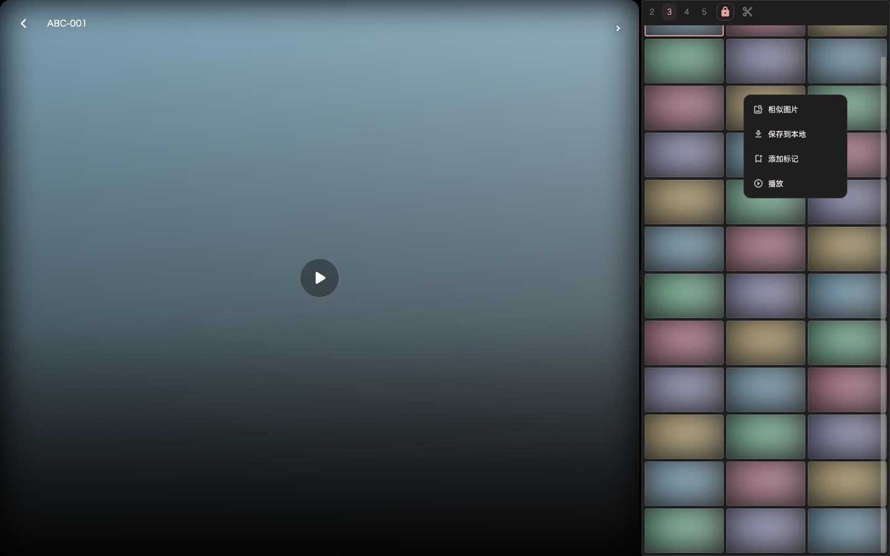

  从缩略图右键 → 相似图片

  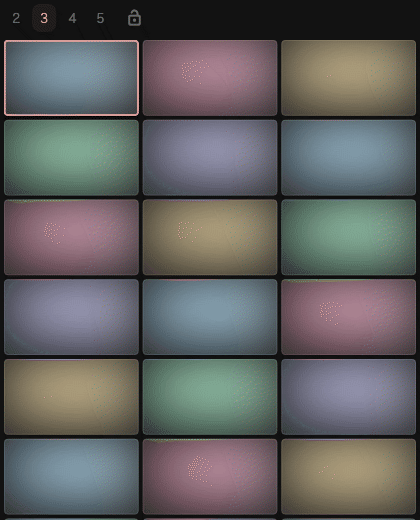
  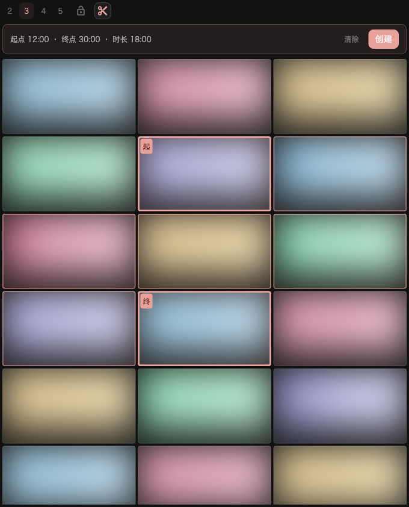

  缩略图时间轴 / 圈选切片

  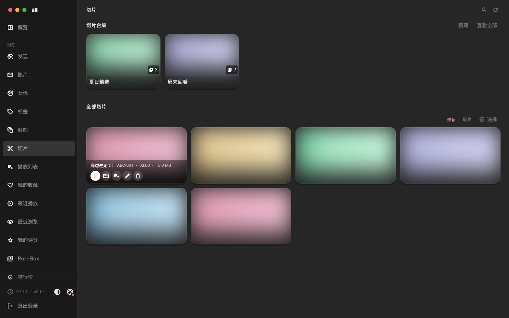

  切片页：浏览、播放、加入合集

  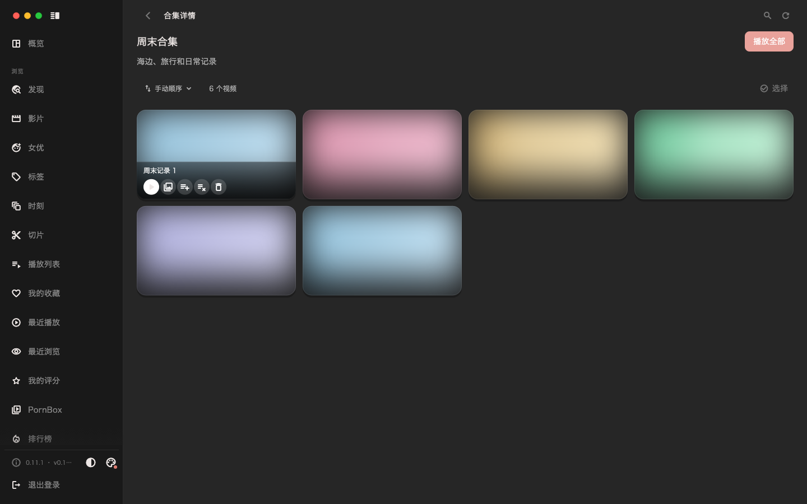

  PornBox 合集：成员、手动顺序、播放全部

  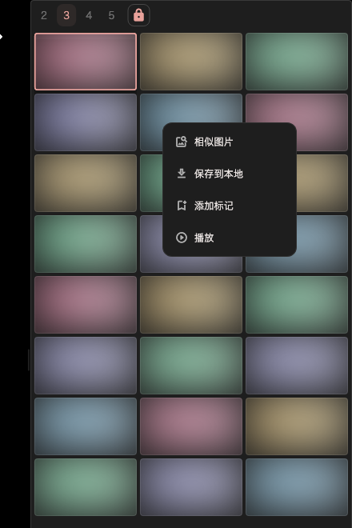

  合集连播：缩略图面板按合集拼接；右键 → 添加标记

  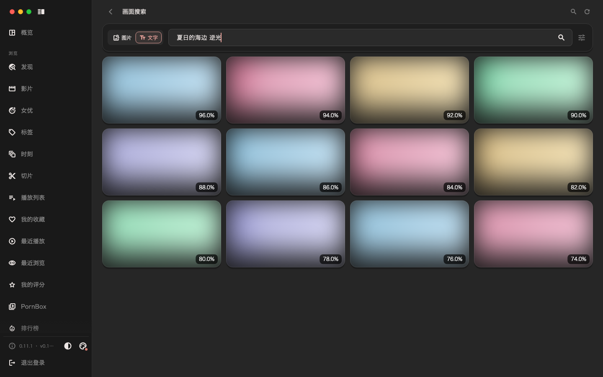

  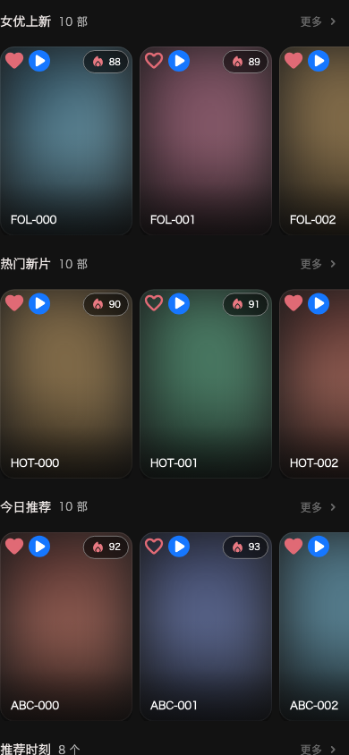

## 怎么存、怎么下

NAS 不是必须的：后端可以跑在任何能长期运行 Docker 的机器上，影片存在哪里由存储插件决定。

| 组合 | 存储 | 下载 | 适合 |
| --- | --- | --- | --- |
| 💾 本地 + qBittorrent（后端镜像预装） | 本地磁盘 / NAS 挂载目录 | qBittorrent | 有本地空间，希望影片留在自己手里 |
| ☁️ 115 网盘 + 离线下载 | 115 网盘 | 115 离线下载 | 不想占本地空间，适合迷你主机、服务器或 VPS |
| ☁️ 光鸭云盘 + 云添加 | 光鸭云盘 | 光鸭云添加 | 不想占本地空间，适合迷你主机、服务器或 VPS |

> 存储和下载都通过插件接入。后端镜像已预装「本地存储与 qBittorrent」；115 网盘和光鸭云盘是可选插件，需要自行在「系统设置 → 插件」中安装。

## 下载与安装

客户端从 [GitHub Releases](https://github.com/tinypinglite/sakuramedia/releases/latest) 下载。Windows 和 macOS 安装包当前未签名，系统可能提示来源不明；请确认下载来源后按系统提示允许运行。

| 平台 | 安装包 | 说明 |
| --- | --- | --- |
| Windows | `sakuramedia-windows-*-setup-unsigned.exe` | 未签名；SmartScreen 提示时选择「更多信息 → 仍要运行」 |
| macOS | `sakuramedia-macos-*-unsigned.dmg` | 未签名；首次打开需右键 → 打开，或在「隐私与安全性」中允许 |
| Android | `sakuramedia-android-*-release-signed.apk` | 直接安装；系统可能提示未知来源 |
| iOS | `sakuramedia-ios-*-sidestore-ready.ipa` | 需要 iOS 15.0+，通过 SideStore 或自签工具安装；没有侧载经验建议先用桌面端 |

> **版本配套**：客户端、后端和插件需要配套升级。下载客户端后，请查看对应 Release 说明中的最低后端版本；跨版本混用可能出现接口错误。后端项目：[tinypinglite/sakuramediabe](https://github.com/tinypinglite/sakuramediabe)。

## 快速开始

1. **部署后端**：按 [快速开始](https://tinypinglite.github.io/sakuramedia/guide/quick-start) 用 Docker Compose 启动后端，默认端口 `38000`。后端建议 4 核 CPU、2GB 以上内存，运行数据放在 SSD；影片存 115 时不需要大容量本地盘。
2. **下载并登录客户端**：首次登录填写后端地址，例如 `http://你的IP:38000`；默认账号 `account / account`，登录后请立即修改密码。
3. **创建媒体库并导入影片**：后端镜像已预装「本地存储与 qBittorrent」，创建媒体库后即可导入宿主机上已有的影片；需要自动下载时，再按 [自动下载与索引器](https://tinypinglite.github.io/sakuramedia/guide/auto-download) 配置 qBittorrent 和索引器（Jackett / Prowlarr）。

完整步骤、路径映射、自动下载和插件选择见 [快速开始](https://tinypinglite.github.io/sakuramedia/guide/quick-start)、[容器路径与硬链接](https://tinypinglite.github.io/sakuramedia/guide/container-paths)、[自动下载与索引器](https://tinypinglite.github.io/sakuramedia/guide/auto-download) 与 [推荐插件](https://tinypinglite.github.io/sakuramedia/guide/plugins)。

## 适合谁

**适合**：有 NAS、迷你主机、服务器或 VPS 等可长期运行的环境，希望把影片发现、下载、导入和观看放在一个地方的人。

**不适合**：没有可长期运行的环境、希望装个 App 就能直接看，或不愿意做任何后端/插件配置的人。SakuraMedia 不提供影片资源，也不内置资源站点。

## 社区与支持

- 发现 Bug 或有功能建议：[提交 Issue](https://github.com/tinypinglite/sakuramedia/issues)。请附上客户端、后端和插件版本、复现步骤与相关日志；请勿上传不宜公开的影片截图、封面或个人信息。
- 使用交流或求助：[参与 Discussions](https://github.com/tinypinglite/sakuramedia/discussions)。
- 遇到连接或导入问题，先在「概览 → 组件诊断」检查媒体库、索引器、JavDB 和嵌入服务的连通性。
- 也可以把 `wiki/` 目录的 Markdown 交给 AI，说明你的问题和已尝试的步骤，通常能更快定位。
- 项目处于快速迭代阶段；升级前请查看 Release 说明，前后端与插件尽量一起升级。

## 参与贡献

- 点一个 Star，让更多人看到这个项目。
- 帮助改进 [Wiki](https://tinypinglite.github.io/sakuramedia/) 和文档。
- 开发插件：查看 [插件开发文档](https://tinypinglite.github.io/sakuramedia/guide/plugin-development)；上架插件市场请向 [sakuramedia-plugin-market](https://github.com/tinypinglite/sakuramedia-plugin-market) 提交 PR。
- 提交 Bug 修复或新功能 PR。客户端使用 Flutter 开发，当前基线为 3.47.2；`flutter pub get` 后可用 `./scripts/test.sh -j 4` 运行测试。

本项目不需要捐赠；Star、文档、插件和 PR 都是帮助。

## 风险与声明

- 本项目仅用于技术交流，不提供任何影片资源或下载链接。
- 用户使用本工具产生的一切后果由使用者自行承担，与作者无关。
- 请在使用前了解并遵守当地法律法规；如使用行为违反当地法律，请勿使用。
- 禁止将本软件用于商业用途。
- 若不同意上述任意一条，请勿使用。
- License: [PolyForm Noncommercial 1.0.0](./LICENSE)

<h2 align="center">Star History</h2>

  <a href="https://github.com/tinypinglite/sakuramedia/stargazers">
    <picture>
      <source media="(prefers-color-scheme: dark)" srcset="https://tinypinglite.github.io/sakuramedia/star-history-dark.svg" />
      <source media="(prefers-color-scheme: light)" srcset="https://tinypinglite.github.io/sakuramedia/star-history-light.svg" />
      
    </picture>
  </a>

